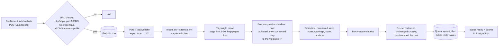

# Architecture

## Components

| File | Role |
|---|---|
| `server.js` | Express API: security headers/CORS, admin auth + audit log, validation, background indexing jobs, dashboard API, chat pipeline, model routing, answer guards |
| `policyCheck.js` | Deterministic policy comparisons: reads time limits, exclusions and amount caps from retrieved text and decides refund/eligibility questions that state a time or amount |
| `chatbotRegistry.js` | Chatbot records and settings in PostgreSQL; URL validation and public-IP (SSRF) checks at registration |
| `ingest.js` | Crawler (Playwright) with pinned, SSRF-checked connections; robots.txt; sitemaps; help-centre URL rules; help-article extraction; block-aware chunking; batched embeddings with reuse; Qdrant writes |
| `dbPool.js`, `db/schema.sql`, `db/setup.js` | PostgreSQL connection and idempotent schema |
| `public/index.html` | Dashboard: chatbots, status/progress, test preview, settings, install snippet |
| `public/widget.js` | Embeddable floating chat widget (Shadow DOM) |
| `public/widget.html` | Full-page chat for one chatbot (`?chatbotId=`); used as the dashboard preview |
| `documents.js`, `documentSupervisor.js`, `documentWorker.js` | Uploaded documents: validation, storage, indexing; PDF/DOCX parsing in a separate reader process (started and timed by a supervisor thread) with time and memory limits and a .docx expansion check |
| `tools/diagnose.js` | Admin diagnostics CLI (sends the admin key only to localhost, or to HTTPS with `--allow-remote`) |
| `demo/customer-site.html`, `demo/serve.js` | **Test host only** (not the product): a pretend customer website on its own origin (`npm run demo:host` → `http://localhost:5050/`) containing the Install-tab snippet |
| `tests/` | Plain Node test scripts (see [TESTING.md](TESTING.md)); `docs/` documentation; `backups/` local snapshots (git-ignored) |

## Data model

- **PostgreSQL `chatbots`** — `id` (UUID, the tenant key), `website_url`, `allowed_domain`, `status`
  (`pending` → `indexing` → `ready` / `failed`); settings `display_name`, `welcome_message`, `accent_color`,
  `allowed_origins`; last indexing result `last_indexed_at`, `pages_indexed`, `pages_failed`, `chunks_indexed`,
  `crawl_complete`, `page_limit`, `last_error`; `support_email` ("Email your question").
- **PostgreSQL `documents`** — one row per uploaded file (`chatbot_id` cascade, `filename`, `storage_name`, `status`,
  `pages`, `sections`, …); `visitor_access` (default false) allows signed visitor links.
- **Qdrant `website_content`** — one point per chunk; 768-dimensional `nomic-embed-text` vectors (cosine). Payload:
  `chatbotId`, `url`, `title`, `heading`, `anchor`, `chunk`, `pageType` (`help` / `content` / …), `isStartPage`,
  `contentHash`, `siteId`, `sourceType`.

`chatbotId` isolates tenants: every search, count, reuse lookup and delete is filtered by it.

## Indexing



- **Discovery.** Links from crawled pages plus URLs from `sitemap.xml` (from robots.txt `Sitemap:` lines, else
  `/sitemap.xml`; index files followed one level; at most 4 files / 2,000 URLs). Pages inside the registered section
  (the start URL's folder) and help/documentation pages are crawled first. If robots.txt names a sitemap on another
  domain, that file is still read, only same-site addresses from it are used, and the site's own `/sitemap.xml` is read
  too. Pages on the other domain are never requested. Only `<a href>` links are followed: buttons are not clicked (design
  for an opt-in: "Click menu buttons" in `HANDOFF.md`).
- **Script-rendered sites.** Every page is rendered in the browser. If the server's HTML is an app shell (under 200
  characters of text and a script file), the crawler waits until no request is open and the text has not changed for 1 s,
  at most 10 s. Other pages keep the 1.5 s wait below 600 characters of text. Requests a page makes to other public
  domains (an API, for example) are allowed, with the same SSRF checks and request budget as any other request.
- **Text extraction.** `<br>` separates words. Buttons under 4 words are removed, longer ones are content. If the
  structured tags hold under 40% of the text, all the text is read instead, still split at the headings.
- **Scope.** The same host (with or without `www.`) plus documentation subdomains of the same domain
  (`help.`, `support.`, `docs.`, `kb.`… of `example.com`). Other subdomains and domains are not crawled.
- **Help-centre URLs.** Paths such as `/help/sign-in` or `/support/reset-password` are articles, not login forms:
  inside a documentation area (`/help`, `/support`, `/docs`, `/faq`, `/kb`, `/guides`, `/articles`, `/hc`…) the
  login/account/payment URL filters do not apply and the page type is `help`.
- **Limits.** Page limit (default 8, max 50), 45 s per page, 250 fetched requests per crawl (images/fonts/media/
  stylesheets and everything inside embedded frames — videos, maps, ads — are never fetched and do not count; a script
  already downloaded in the same crawl is reused from memory and not counted again; when the budget runs out the
  crawl stops and is reported as partial with stop reason `request-limit`), 5 redirects per request, responses over 5 MB cut off
  while downloading, main pages must be HTML, pages answering HTTP ≥ 400 are failures. `robots.txt` rules for `*`
  are respected.
- **One copy per page.** `www.` and the bare domain are the same website; a page is stored under its final address
  after redirects; a redirect to a page already read is stopped before the page loads; two addresses with identical
  text (`/About-Us` and `/about-us`) are stored once. Sitemaps in `<![CDATA[…]]>` form are read; attachment/image/
  video sitemaps are skipped.
- **Crawl order.** Pages in the start URL's folder get the same +20 priority whether they come from the sitemap or
  from a link; each further read page linking to an address adds +3 (at most +12), so the site's menu pages are read
  early. Images, PDFs and Office files are never queued. The working queue holds the best 60 candidates; candidates
  pushed out of it are kept in a backlog and the queue is refilled from it whenever it runs empty, so a crawl ends
  only when every discovered page was handled or a real limit (page limit, request budget) stopped it. (Before
  hardened-v21 those candidates were dropped, and a crawl could end early while reporting `page-limit`.) Links
  disallowed by robots.txt are reported as skipped when they are found, like sitemap entries.
- **Crawl report.** Each run records pages found (links + sitemap), read, failed (with the first line of the reason)
  and not read because a limit stopped the crawl, plus the stop reason (`complete`, `page-limit`,
  `request-limit`). Stored in PostgreSQL (`pages_discovered`, `pages_not_processed`, `crawl_stop_reason`,
  `crawl_report`), shown in the dashboard Overview ("Last read") and used by the diagnostics. `crawl_report.warnings`
  (full crawls only; no migration): `js-rendered`, `menu-uses-buttons`, `thin-content` (under 500 words read),
  `canonical-other-domain`, `sitemap-other-domain`, `robots-sitemap-other-domain`.
- **URL-level report.** Every address found has exactly one final status — `indexed` (with its sections), `failed`
  (HTTP/network error), `skipped` (with a reason) or `not-processed` (`page-limit` / `request-limit`) — stored in the
  `crawl_urls` table (replaced after each successful crawl) and shown in the dashboard with filters. A page whose loading
  is cut off by our own request limit is `not-processed`, not `failed`. A navigation interrupted by the browser's error
  page from the previous (failed) page is retried once.
- **Transient failures are retried, permanent ones are not.** HTTP 408/425/429/500/502/503/504 up to 3 attempts, timeouts
  and dropped connections up to 2, with a growing pause (1 s, 2 s); 404/403, robots.txt, SSRF-blocked, non-HTML and
  too-many-redirects failures are never retried. Retries are ordinary requests through the same SSRF-checked, pinned
  client and count against the request budget. The real reason is recorded (e.g. "Request timed out.",
  "HTTP 503 (after 3 attempts)") instead of the browser's generic "blocked by client". Each report row also stores the
  page title, the time spent on the address and the number of attempts.
- **Address forms.** `www.example.com/a` and `example.com/a` are one page (`pageKey`). A report entry keeps the first form found, the page is stored under the address it was read at; final statuses are matched by page key (`markIndexedPages`), and the report shows the stored address. A redirect to the same page under another form (trailing slash, `www.`) is read normally; only a redirect to a *different* page already read is stopped early. An e-mail address written as a link without `mailto:` (`href="info@example.com"`) is reported as skipped and never requested.
- **Relative links** are resolved against the page's real final address (after redirects) or its `<base href>`; pages
  are opened at the address as linked (URLs are normalised only to detect duplicates).
- **Extraction** keeps structure: ordered-list items get their numbers (respecting `start=`), bullets get `-`, nested
  items are indented, `<pre>` code keeps its lines, text in note/warning/tip boxes is prefixed `Note:` / `Warning:`,
  and each heading's `id` is kept as the section anchor. Navigation, footers, forms and scripts are removed.
- **Chunking** groups whole blocks (≤ 280 words per chunk), so a step is never split; sections of 8+ words are kept.
  Before chunking, a section repeating an earlier one on the same page (slider/carousel copies) is dropped, and runs of
  consecutive short sections (< 40 words: price cards, plan tiles, feature boxes) are merged into one section with each
  heading inline ("€59: Monthly unlimited membership."). A numbered procedure, a section of normal length or a section
  with its own anchor ends the run.
- **Model context labels** = page title + **page address words** + section heading ("Treadmill on rent … (page: online
  fitness training) - OUR PACKAGES"), the same words the embedding and keyword score use, so the model knows what a
  section describes when a site uses one generic `<title>` for every page.
- **Embedded text** = page title + **page address words** ("/online_fitness_training.php" → "online fitness
  training") + page type + section heading + content. The address words also count in the keyword score, because many
  small sites use one generic `<title>` for every page.
- **Embeddings** are sent to Ollama in batches of 16 (identical to one-by-one embeddings). A chunk whose exact text was
  already embedded for this chatbot reuses the stored vector (SHA-256 of model + text), so re-indexing unchanged
  content skips embedding entirely.
- **Safe replacement.** New points are written first; only then are this chatbot's stale points deleted. A failed or
  empty crawl leaves the previous knowledge in place (status returns to `ready`, `last_error` is recorded).
- **Progress.** Background jobs report `crawling n of limit` with the address being read and its phase
  (`fetching`, `extracting`), live per-address counts from the crawler's URL ledger, `embedding n of m`, `saving`; the
  dashboard polls `GET /api/admin/chatbots` and, while a crawl runs, `GET /api/admin/chatbots/:id/crawl-live` (every
  address with its current status). Progress is kept in memory (lost on restart; the stored counts remain).
- **Report vs stored content.** The report API compares every recorded row with the website sections stored now (page
  key; uploaded documents never count) and returns a current status (`indexed-elsewhere`, `kept-earlier`) without
  changing anything stored. The totals of the last full crawl (`crawl_report.counts`) stay separate from the current
  row counts. `POST …/crawl-urls/continue` processes the next pending addresses (optionally of one section) as a normal
  page-crawl job, one batch per request. A chatbot that already has knowledge stays `ready` while it is re-indexed.
- **Crawling chosen pages.** `POST /api/admin/chatbots/:id/crawl-urls/index` runs the same pipeline on 1–10 addresses
  of the chatbot's website (`onlyUrls`: no sitemap, no link following; robots.txt, skip rules, SSRF and retries
  unchanged) under the same per-chatbot lock as a full crawl. Only pages that produced new sections are replaced (the
  stale-point delete is limited to those addresses); a failed or empty page keeps its earlier sections. Their
  `crawl_urls` rows are replaced individually (`updateCrawlUrls`), and `pages_indexed` / the section count are
  recalculated from the stored data.

## Uploaded documents

`documents.js` + admin routes in `server.js`; table `documents`; files under `data/uploads/<chatbot>/<document id>.<ext>`
(generated names, never served).

1. **Upload** (one file per request, raw body, `X-File-Name` header): extension `.pdf`/`.docx`, real format checked by
   signature (`%PDF-`; ZIP with `word/document.xml`), ≤ 10 MB, ≤ 50 per chatbot, duplicates (SHA-256) refused.
2. **Extraction** (in a reader process per document, `documentWorker.js`, started, timed and killed by the supervisor
   thread `documentSupervisor.js`: 120 s timeout, 512 MB heap; chat keeps answering; killing a stuck reader cannot
   affect the server; the ~0.6 s Windows process start happens on the supervisor thread, not the main thread; if the
   supervisor fails or stops answering, `documents.js` stops its readers by process ID and starts a new supervisor for
   the next document): PDF with
   pdf.js, page by page (a short first line becomes the heading; numbered headings such as `4. Processing Time` start
   new sections inside a page and continue across pages; numbered lists stay inside their section; each section keeps
   its page); DOCX: every ZIP part is
   first really decompressed with a 100 MB total cap (header sizes are not trusted), then mammoth → HTML (images not
   decoded) → the website extractor (headings, lists). Sections are never merged, so citations name the
   right page/heading. No readable text (e.g. scanned PDF) → `failed` with that reason; nothing is stored.
3. **Index**: the same chunking and `nomic-embed-text` embeddings as the website; Qdrant payload `chatbotId`,
   `sourceType: "document"`, `documentId`, `filename`, `page`. New sections are stored before the document's old
   ones are deleted. One document is processed at a time.
4. **Answering**: the same retrieval (filtered by `chatbotId`, so documents never cross chatbots); the model sees
   `Document "file.pdf", page 3 - heading`; sources `{ type: "document", title, page, section }`; at most 2 sections
   per page or document. A website re-index deletes only stale *website* sections; removing a document deletes only its
   sections.
5. **Visitor links** (`addDocumentLinks`, at reply time, also for cached answers): a document source gets
   `link: /api/documents/<signed token>#page=N` only if that document's `visitor_access` is true and it is indexed;
   `GET /api/documents/:token` re-checks this on every open.

## Email escalation

`supportMail.js` (nodemailer over SMTP from `.env`; `EMAIL_TRANSPORT=test` keeps messages in memory). A chat response
with the exact fallback answer carries `contact: true` for a ready chatbot; the
widget then shows the contact form, which posts to `POST /api/chat/contact`, which sends one email per
`requestId` to the support address (Reply-To: the visitor).

## Answering

```mermaid
flowchart LR
    Q[Widget: POST /api/chat] --> V{valid ID, text ≤ 500,<br/>chatbot ready,<br/>allowed website?}
    V -- no --> E[400 / 403 / 404 / 409]
    V -- yes --> C{cached for this<br/>chatbot + question?}
    C -- yes --> OUT
    C -- no --> S[Embed question<br/>(+ previous question if a short follow-up)<br/>→ Qdrant, filter chatbotId]
    S --> R[Rerank; keep chunks within 0.15<br/>of the best match, max 5]
    R -- none --> NF[Exact fallback]
    R --> P{policy comparison<br/>decidable from the text?}
    P -- yes --> PA[Computed verdict quoting<br/>the matching rule]
    PA --> SRC
    P -- no rule for this product --> NF
    P -- no --> G{subject words on<br/>the website?}
    G -- no --> NF
    G -- yes --> M{policy question about<br/>the visitor's situation?}
    M -- no --> F[Fast model]
    M -- yes --> T[Reasoning model]
    F --> CHK{guards}
    T --> CHK
    CHK -- fail --> NF
    CHK -- pass --> SRC[Sources: pages the answer used,<br/>link to section anchor]
    SRC --> OUT[Answer + sources]
```

- **One generic system prompt** for all tenants. Website text and the visitor's question are untrusted data; the prompt
  tells the model to ignore instructions inside either. For "how do I" questions it asks for the documented steps as a
  numbered list in the original order, with prerequisites, notes, warnings and the exact menu/button names; for policies,
  every condition, exception, time limit and price exactly as written. Nothing for any specific website is hardcoded.
- **Deterministic policy checks** (`policyCheck.js`). When the visitor states a time ("45 days ago", "3 weeks ago") or an
  amount ("$250") and asks about a refund, cancellation, return or claim, the comparison is computed, not left to the
  model. Rules are read from the retrieved text one bullet/sentence at a time: "within N days/weeks/months",
  "after N days … no refund", exclusions ("not refundable"), and caps ("up to $200"). The rule that names the visitor's
  product (shared words) is used; a product exclusion overrides a general time window; vague rules ("most products")
  are never used. Outcomes: *eligible* / *not eligible* (answer quotes the rule and states the comparison), *needs
  detail* (no product named, two products with different limits, or a month count within 3 days of the limit: the
  answer quotes the rules and asks), *undetermined* (the policy names no rule for this product: exact fallback). Anything
  else (no date, no matching rule type) goes to the model as before. Months count as 30 days, years as 365.
- **Model routing** (`LLM_MODEL` / `LLM_REASONING_MODEL`). Most questions go to a fast non-thinking model. A thinking
  model is used only for policy questions (refund, cancellation, eligibility, claim, warranty, fee…) in which the visitor
  describes their situation (a number, or words like "ago", "after", "still", "if I") and that the deterministic check
  could not decide. General questions that merely contain a number stay on the fast model (a benchmark question
  "If I have 3 nested functions…" took 87 s on the thinking model before this rule).
- **Model placement** (measured, hardened-v21). Per answered question, retrieval (embedding + two parallel Qdrant
  queries) takes 0.1-0.5 s and context building < 5 ms; > 85 % of the time is the model: reading the prompt (~140
  tokens/s on the GTX 1650 whatever the batch size: compute-bound) and writing the answer. Ollama's own placement left
  ~1.1 GB of the 4B model on the CPU (15 tokens/s; the thinking model 8.5). The answer model now runs completely on
  the GPU (`LLM_NUM_GPU`, default `all`: 43 tokens/s; thinking model 37.5) and every embedding (questions, crawling,
  documents) on the CPU (`EMBED_NUM_GPU`, default `0`), because both models on the GPU do not fit in 4 GB and Ollama
  then reloads both for every question (+15 s). CPU and GPU embeddings agree (cosine 0.9999997). If the model cannot be
  loaded with all layers on the GPU (Ollama error), the request is retried with Ollama's placement, which is then kept.
  Set either to `auto` to let Ollama decide (e.g. on a GPU with room for both). Each answer logs a `Timings:` line with
  `embedMs`, `embedLoadMs`, `searchMs`, `rerankMs`, `contextMs`, `contextChars`, `generationMs`, `modelCalls`, `loadMs`
  (model load), `promptTokens`/`promptMs`, `outputTokens`/`outputMs` and `thinkingChars`.
- **Guards that fail closed** (answer replaced by the exact fallback):
  - the question's subject ("what is X") must appear in the retrieved text (at least half of its words);
  - output cut off by the token limit, reasoning text or raw context labels (a reply that narrates the task — "Okay",
    "Let me", "We are asked…", "We need to find … in the excerpts" — is rejected; first-person business answers such
    as "We are open on Saturday…", "We are located at…" or "We will answer your email within 24 hours" are not;
    task verbs count only with a task object — "answer the question", "look up the answer", "search the excerpts",
    "the information provided". Not caught: narration without such an object, e.g. "We should consider the hours
    listed"; such replies still go through the number, link and grounding checks);
  - numbers, emails and URLs must appear in the retrieved text or in the visitor's own question
    (step numbers like "1." are formatting and ignored).
- **Keyword and heading scores** fold simple plurals ("strings" matches "string"; words ending in "ss" are kept) and
  count only the page's own name from its address ("/3/library/string.html" -> "string"), never folder names such as
  "library" or "help", so a folder cannot make every section below it look relevant.
- **Answer-type evidence**: a question asking for a price/cost/fee, opening hours, or contact details gives a +0.05 bonus
  to sections that contain a money amount (currency symbol or code), a clock time or weekday, or a phone number/e-mail.
  It does not depend on the question sharing words with the section ("price list for remote sessions" vs a card with
  "₹1200 weekly plan"), and it is the same for every website. Side effect: on such questions, weakly related sections
  without that evidence fall below the 0.15 relevance margin sooner. Intent words are English.
- **Closest meaning match kept**: the section with the highest vector score is always among those sent to the model when
  it passes the relevance rules (keyword reranking may reorder sections, not push out the best semantic match). If the
  6000-character context limit would drop it, the lowest-ranked other sections are removed until it fits; the order
  of the remaining sections is unchanged (moving it to the front changed the model's answers). `createContext` returns
  the context text and the exact sections in it; only those sections can be cited.
- **Relevance selection** (max 5 sections, max 2 per page, within 0.15 of the best score) also skips a section whose text
  is nearly identical (≥ 80 % shared words) to one already chosen, so templated pages or repeated blocks on several
  pages cannot fill every slot.
- **Sources** support specific claims: each sentence or list item of the answer is matched to the retrieved section
  containing most of its words (≥ 50 %); a long sentence that joins two statements (", and …", ", which …", ", but …",
  ", while …", "; …") is matched clause by clause when every clause has at least 5 words, so facts from two sections in
  one sentence are both cited and a short tail cannot pick up a citation of its own; when a claim contains numbers (prices, times) and some sections contain all of
  them, only those sections can be its source; among near-equal sections a specific page beats the homepage, then the
  section most relevant to the question. An answer of numbers only ("€59.") is cited only from a section containing
  all of them, ignoring currency symbols, comma/space thousands separators and zero decimals; if none does, no source
  is shown (never simply the first retrieved section). Only sections that support a claim are cited, the one
  supporting most of the answer first; `www.`/bare-domain/trailing-slash variants are one card (at most 3 pages). Every card is an indexed
  page (`url` from the stored data, `#anchor` only if that section had one) with `title`, `section` and `link`, shown
  in the widget as a small chip ("section · domain").
- **Cache** keyed by chatbot + (previous question for follow-ups) + question; cleared when that chatbot is re-indexed.
- **Capacity.** One generation at a time (+2 waiting), one question at a time per visitor IP, generation cancelled when
  the visitor disconnects, 240 s timeout.

## Security boundaries

| Boundary | Control |
|---|---|
| Admin vs public | `x-admin-api-key` (named keys, rotation, SHA-256 + constant-time compare, fails closed, audit log); no CORS on admin routes |
| Tenant vs tenant | `chatbotId` filter on every Qdrant operation; cache key includes the chatbot; reuse lookups per chatbot |
| Server vs internal network | DNS/IP validation at registration, before indexing, and on every crawler request, redirect hop, robots.txt and sitemap; connections pinned to the validated IP; WebSockets and service workers blocked; ports 80/443 |
| Widget vs host page | Shadow DOM; text-only rendering; validated attributes; optional allowed-websites list per chatbot; document links only if they start with `/api/documents/` |
| Documents vs visitors | Private unless opened per document; signed 1-hour links re-checked on every open |
| Server vs browser | JSON-only errors without internals; only `/`, `/index.html`, `/widget.js`, `/widget.html` served; `nosniff`; `X-Frame-Options: DENY` except widget files |

See [SECURITY.md](SECURITY.md) for residual risks.
